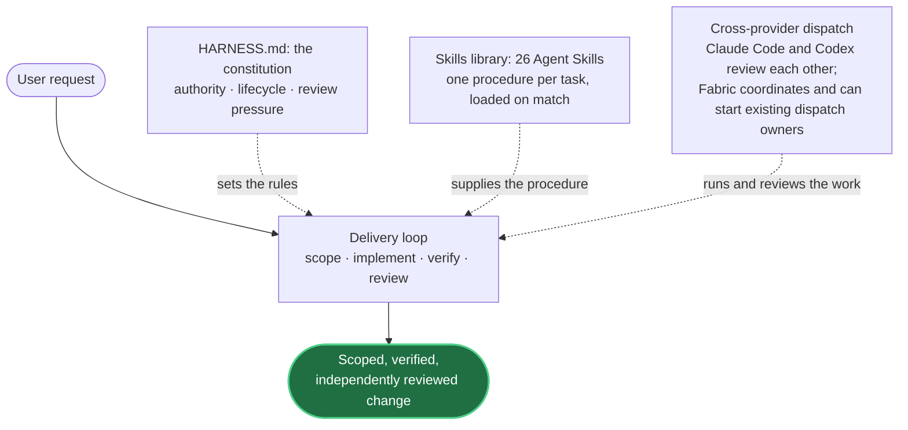
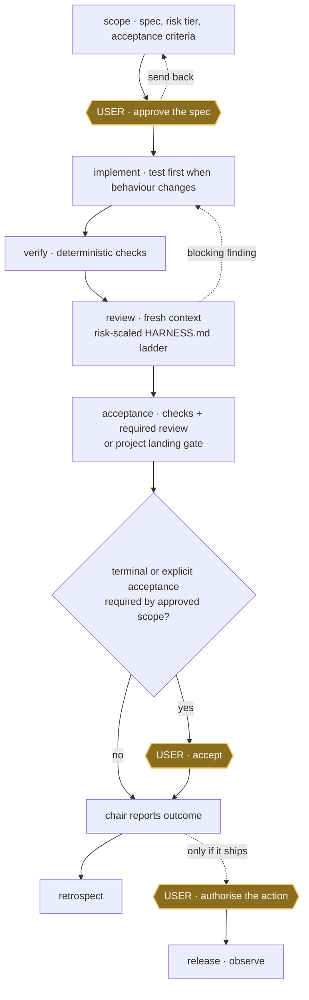

# Provenant

**A personal harness for Claude Code and Codex that turns agent work into a
scoped, verified and independently reviewed delivery workflow.**

[](https://github.com/mblauberg/provenant/actions/workflows/ci.yml)
[](LICENSE)

Provenant is a personal harness, used daily by its author. Interfaces change
without notice and support is best effort. Propose changes through
[GitHub issues](https://github.com/mblauberg/provenant/issues); report
vulnerabilities privately through [`SECURITY.md`](SECURITY.md).

## Why Provenant

A bare coding agent will write and "finish" a change in one pass, with its own
author as the only reviewer. Provenant puts structure around that:

- it **scopes** work in dialogue with the user, returning open decisions as
  questions, and requires approval before implementation starts;
- it runs **deterministic checks** before any result surfaces for review;
- substantial work adds **one independent review** from another provider
  family when available, with review depth increasing at higher risk tiers; and
- it meets **acceptance through checks and required review**, with separate user authority for release.

A change therefore arrives already scoped, verified and read by a context that
did not write it, so user attention goes to judgement rather than to catching an
agent's own mistakes.

## How it fits together

Three parts act on every request at once: the constitution sets the rules, a
skill supplies the procedure, and cross-provider dispatch runs and cross-reviews
the work.
None of them is a stage the work passes through.



- **Harness:** [`HARNESS.md`](HARNESS.md) is the constitution. It sets
  authority, the delivery lifecycle, and how much review pressure each risk tier
  owes, and stays small so it can be read every session.
- **Skills:** the <!--skills-->25<!--/skills--> Agent Skills are task-specific
  procedures, one folder with a `SKILL.md` each. Only the one-line descriptions
  sit in permanent context; a full body loads only when the task matches it.
- **Fabric:** messages, shared tasks and activity between agents working on one
  project, plus two MCP tools that delegate ordinary dispatch and finite batches
  to the existing owners. One SQLite file, no daemon, nothing to provision.

## Quick start

The `provenant-config` Rust crate owns release stamping and managed-file
installation. It packages typed `release.json`, installs immutable releases and
publishes the install receipt last. These are library entrypoints; CLI wiring for
`install`, `check install` and `uninstall` is a later cut-over. The legacy
`install-harness`, `install-skills` and `check-provenant-install.py` entrypoints
refuse the retired Python installation path.

For checkout development, install the locked Python and Node tools, then run the
Rust config checks and Node preflight:

```sh
uv sync --locked --only-group test
npm ci
(cd tools/front-door && cargo test -p provenant-config)
npm run check
```

`provenant check harness` validates tracked skills, local assets, Markdown
links and issue forms in the selected project. `npm run check` validates dependencies for that checkout and reports
missing packages; it never installs or borrows another checkout's tree.

## Providers

The [Fabric MCP registration notes](docs/runbooks/fabric-mcp-registration.md)
document the legacy registry editor and the pending Rust client cut-over. Fabric
registration and direct provider execution are separate; current dispatch
activation is owned by [adapter compatibility](config/adapter-compatibility.yaml).

| Client or provider | Fabric MCP registration | Direct provider execution |
|---|---|---|
| Claude Code | Supported | Enabled Anthropic primary |
| Codex | Supported | Enabled OpenAI primary |
| Agy | Supported | Enabled optional broker; the receipt records the runtime model family |
| Cursor | Supported | Enabled optional Composer/Grok and hosted third-party broker |
| Kiro | Supported | Disabled; see [`kiro-acp` policy](config/adapter-compatibility.yaml) |
| OpenCode | Supported | Enabled optional free/Zen worker (`opencode/<model>`); explicit model required |

Provider CLI versions and digests are diagnostic observations, not admission
locks. Direct dispatch enforces the checked-in activation decision and uses
fresh adapter capability evidence where the route requires it; a CLI update
does not by itself require a compatibility-table edit.

Claude account selection preserves the inherited `CLAUDE_CONFIG_DIR` when using
its ambient identity, including leaving it unset. Confined non-default lanes use
their configured directory and its `.claude.json`, without access to `~/.claude.json`.
On macOS, Keychain items are shared across accounts: folder isolation is not
credential isolation. Account directories separate CLI state, not the Keychain.

## Core workflows

Each task has a front-door skill; the agent loads it when a request matches.

| Need | Skill |
|---|---|
| Agree what to build | [`scope`](skills/scope/SKILL.md) |
| Deliver an approved code change | [`implement`](skills/implement/SKILL.md) |
| Deliver research, analysis or documents | [`deliver`](skills/deliver/SKILL.md) |
| Find a root cause | [`diagnose`](skills/diagnose/SKILL.md) |
| Review without changing the code | [`code-review`](skills/code-review/SKILL.md) |
| Coordinate parallel agents | [`orchestrate`](skills/orchestrate/SKILL.md) |
| Promote an accepted artefact | [`release`](skills/release/SKILL.md) |

## Lifecycle

Every change runs the delivery loop. Users approve scope and one-way doors;
objective checks and tier-required review meet delivery acceptance. The chair
reports the outcome and the user may still reject it. Explicit user acceptance
is required only for `terminal` work or when the approved scope asks for it.
A project may name its landing gate as acceptance. Release keeps its separate
user authority; receipts declare approval rather than authenticating it.



Gold hexagons are user gates. Specification approval and any required explicit
acceptance can return work for revision. Scoping is usually a conversation:
a decision packet with choices and a recommendation, owner calls parked as named questions rather
than guesses, and the [`grill-me`](skills/grill-me/SKILL.md) interview, one
question per round, while material decisions stay unresolved.

The loop is [`deliver`](skills/deliver/SKILL.md), the kernel binding one run to one receipt;
[`implement`](skills/implement/SKILL.md) is its software front door, and the
full lifecycle lives in [`docs/ARCHITECTURE.md`](docs/ARCHITECTURE.md).

## What the harness guarantees

**Review pressure scales with risk.** Routine work uses the chair and objective
checks. Substantial work adds one independent cross-family review when available;
crucial work needs two with distinct lenses and two non-chair families when
available. Terminal work adds an adversarial lens. The
[`HARNESS.md` Review ladder](HARNESS.md#review-ladder) owns the thresholds and
recorded-blocker fallback when cross-family coverage is unavailable.

Only passing independent reviews count towards coverage. Evidence and
corroboration, not model votes, make a finding blocking.

**Durable boundaries hold regardless of tier:**

- access and credentials never grant authority;
- creating branches and worktrees for implementation is pre-authorised;
  merge authority comes from the owning repository (this repo grants it through
  its [GitHub runbook](docs/runbooks/github-workflow.md)); deletion beyond
  post-merge pruning, force-removal and unauthorised shared-branch pushes stay
  gated;
- no two agents write one source surface at once; and
- specification approval and release remain user decisions; final acceptance needs a user only for `terminal` work or approved scope
  ([`HARNESS.md`](HARNESS.md)).

Provider workers can be dispatched through Fabric MCP or the direct command
line; both paths use the same orchestration owners and retain full output in run
files. Fabric also carries messages, shared tasks and activity between agents.
[Herdr](https://herdr.dev) is optional: it observes and sends fire-and-forget
steering; it does not provide wake, callback or completion delivery.

## Skill library

The full <!--skills-->25<!--/skills-->-skill catalogue, grouped by area:

<!-- skill-catalogue:start -->
<details>
<summary>All 25 skills</summary>

| Area | Skills |
|---|---|
| Delivery | [`session`](skills/session/SKILL.md), [`scope`](skills/scope/SKILL.md), [`grill-me`](skills/grill-me/SKILL.md), [`deliver`](skills/deliver/SKILL.md), [`implement`](skills/implement/SKILL.md), [`tdd`](skills/tdd/SKILL.md), [`refactor`](skills/refactor/SKILL.md), [`diagnose`](skills/diagnose/SKILL.md), [`code-review`](skills/code-review/SKILL.md), [`evaluate`](skills/evaluate/SKILL.md), [`release`](skills/release/SKILL.md), [`retrospect`](skills/retrospect/SKILL.md), [`work-map`](skills/work-map/SKILL.md), [`setup-repo`](skills/setup-repo/SKILL.md), [`tracker`](skills/tracker/SKILL.md) |
| Orchestration | [`orchestrate`](skills/orchestrate/SKILL.md), [`autopilot`](skills/autopilot/SKILL.md) |
| Writing and documentation | [`engineering-docs`](skills/engineering-docs/SKILL.md), [`engineering-writing`](skills/engineering-writing/SKILL.md), [`legal-writing`](skills/legal-writing/SKILL.md), [`natural-writing`](skills/natural-writing/SKILL.md) |
| Design and diagrams | [`ui-ux-design`](skills/ui-ux-design/SKILL.md), [`prototype`](skills/prototype/SKILL.md), [`d2-diagrams`](skills/d2-diagrams/SKILL.md) |
| Harness development | [`skill-craft`](skills/skill-craft/SKILL.md) |

</details>
<!-- skill-catalogue:end -->

### Stack library

[`library/`](library/) holds four stack skills kept apart from the workflow
skills above: [`playwright`](library/playwright/SKILL.md),
[`react-performance`](library/react-performance/SKILL.md),
[`tanstack-query`](library/tanstack-query/SKILL.md) and
[`typescript-clean-code`](library/typescript-clean-code/SKILL.md). They install
through the same installer and manifest, into the same `skills/` directory of
each client, as managed links. A library skill may not share a name with a
workflow skill. Removing a folder from `library/` and re-running the installer
prunes its link.

## Documentation and help

- [`Architecture`](docs/ARCHITECTURE.md): system structure and design rationale.
- [`Specifications`](docs/specs/README.md): the component contracts.
- [Fabric hosts](docs/runbooks/fabric-hosts.md): SSH peer configuration and diagnostics.
- [Landing lease](docs/runbooks/landing-lease.md): Fabric landing-lease requirements and the Rust cut-over gap.
- [Local telemetry](docs/runbooks/telemetry.md): supervised attempt usage, API-equivalent cost estimates, rewrite status and quota ownership.
- [Harness profiles](docs/runbooks/harness-profiles.md): switching cost/quality presets and comparing them.
- [`Research`](docs/research/README.md): evidence and owners.
- [`Skill portfolio evaluation`](docs/evals/skill-portfolio-2026/README.md): the retained routing evidence.
- [`Maintenance`](MAINTAINING.md): how the repository is changed and governed.
- [`Security`](SECURITY.md): private vulnerability reporting.
- [GitHub issues](https://github.com/mblauberg/provenant/issues): normal feedback and change proposals.

Historical archives, effort route maps, handoffs and superseded evaluation
bundles were pruned from the working tree; they stay reachable at the
`docs-archive-2026-09-02` tag.

Legal: [MIT licence](LICENSE) · [Notices](NOTICE) ·
[Third-party notices](THIRD_PARTY_NOTICES.md) ·
[Acknowledgements](ACKNOWLEDGEMENTS.md)
