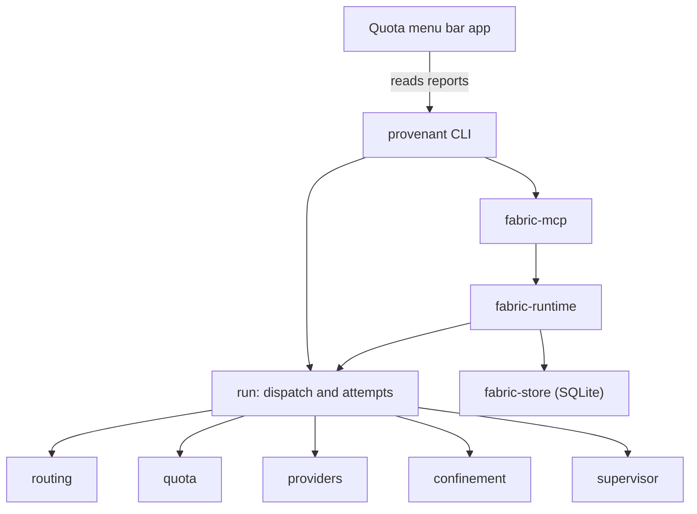

<p align="center">
  <picture>
    <source media="(prefers-color-scheme: dark)" srcset="./assets/brand/provenant-icon-dark.svg">
    
  </picture>
</p>

<h1 align="center">Provenant</h1>

<p align="center">An agent harness for running coding agents as confined, recorded work lanes, with Fabric coordination and quota-aware routing.</p>

<p align="center">
  <a href="https://github.com/mblauberg/provenant/actions/workflows/ci.yml"></a>
  <a href="LICENSE"></a>
  <a href="tools/front-door/rust-toolchain.toml"></a>
</p>

## What it is

Provenant coordinates coding agents as bounded work lanes. Each lane has an
explicit access mode and a recorded result. A Rust host, the `provenant` CLI,
routes work to models, tracks quota and run state, carries messages between
agents, and controls how a writer's changes reach a remote branch.

It is for developers who run coding agents in parallel and want isolated
worktrees, shared task communication, predictable model selection and a
reviewable path from a writer lane back to a branch. The repository also holds
the harness rules and skills that agents follow; see the
[documentation map](#documentation).

## Features

- **Confined provider lanes.** Claude Code, Codex, Cursor, Agy and OpenCode lanes
  run under read-only or worktree-write access plans, with output and terminal
  state recorded.
- **Fabric.** Messages, tasks, claims and agent identity through the CLI and an
  MCP server, with dispatch to configured peer hosts.
- **Weighted, paced routes.** Named pools choose among eligible models by
  configured weight and provider pacing.
- **Quota-aware admission.** Provider quota windows and account status decide
  route eligibility and dispatch admission.
- **Host-side delivery.** The host verifies a writer's final head and pushes it
  with its own Git authority. It can optionally open a pull request.
- **Worktrees and hooks.** `provenant worktree` manages isolated worktrees;
  `provenant hook` runs harness and Git hook handlers.
- **Telemetry.** Local usage and cost reports, and trace export for Perfetto.
- **Quota menu bar app.** An optional macOS app that displays quota snapshots.

## Requirements

- Rust 1.99.1, pinned by [`rust-toolchain.toml`](tools/front-door/rust-toolchain.toml).
- Git.
- For dispatch, at least one supported provider CLI installed and signed in.
- macOS 14 or later for the optional menu bar app. CI builds the release binary
  on macOS and runs the workspace checks on Linux.

## Install

Build the binary and stage a release from a checkout:

```sh
cd tools/front-door
export PATH="$HOME/.cargo/bin:$PATH"
CARGO_PARENT="$(mktemp -d)"
export CARGO_TARGET_DIR="$CARGO_PARENT/cargo-target"
RELEASE="$(mktemp -d)/release"
cargo build --release --locked --bin provenant
cargo run --locked --example package-release -- --out "$RELEASE"
rm -rf -- "$CARGO_PARENT"
unset CARGO_TARGET_DIR CARGO_PARENT
```

Preview an install for one harness, review the plan, then apply it. Repeat
`--harness` to select more than one of `claude`, `codex`, `cursor`, `agy` and
`opencode`.

```sh
STATE="$HOME/.local/share/provenant/v1"
"$RELEASE/bin/provenant" --state-dir "$STATE" install \
  --source "$RELEASE" --harness claude --bin-dir "$HOME/.local/bin" --dry-run
"$RELEASE/bin/provenant" --state-dir "$STATE" install \
  --source "$RELEASE" --harness claude --bin-dir "$HOME/.local/bin"
```

Close the selected harness before applying. Hooks are off on first install;
`--hooks on` enables them, and omitting `--hooks` on reinstall keeps the
current ownership. To remove an integration, run
`provenant uninstall --harness <name>`. The
[install runbook](docs/runbooks/install.md) covers release contents, Fabric MCP
registration, migration and recovery.

## Quick start

```sh
provenant help
provenant route list
provenant route resolve --route junior
provenant quota show
```

Claude and Codex lanes need `provenant accounts register` first; see the
[install runbook](docs/runbooks/install.md#install). The next command starts a
real read-only lane and uses that provider's quota:

```sh
printf '%s\n' 'Summarise this repository structure in three bullets.' | \
  provenant dispatch \
    --operation-id "readme-smoke-$(date +%s)" --prompt-stdin \
    --route junior --mode read-only
provenant lanes --all
```

`provenant help dispatch` lists every dispatch control, including `--worktree`,
`--deliver-remote`, `--deliver-branch`, `--open-pr` and `--host`.

## How it fits together



The CLI is the composition edge. Each crate under
[`tools/front-door/crates/`](tools/front-door/crates) owns one decision and may
depend only on the crates beneath it. Machine-local state lives under
`~/.local/share/provenant/v1`; `--state-dir` selects another root. The
[architecture overview](docs/ARCHITECTURE.md) has the full crate map and state
layout.

## Documentation

| Document | Covers |
| --- | --- |
| [Architecture](docs/ARCHITECTURE.md) | Components, crate map, state root and lifecycle |
| [Specifications](docs/specs/README.md) | Per-subsystem contracts |
| [`HARNESS.md`](HARNESS.md) | The runtime constitution for agents |
| [Install](docs/runbooks/install.md) | Build, package, install, uninstall, Fabric MCP |
| [Configuration](docs/runbooks/configuration.md) | Profiles, knobs and quota display |
| [Model routing](docs/runbooks/model-routing.md) | Pools, weights and pacing |
| [Providers](docs/runbooks/providers.md) | Per-adapter launch notes |
| [Fabric hosts](docs/runbooks/fabric-hosts.md) | Peer hosts and peer dispatch |
| [Worktrees](docs/worktrees.md) | Worktree policy and writer dispatch |
| [Telemetry](docs/runbooks/telemetry.md) | Usage, cost and trace export |
| [Quota menu bar](apps/quota-menubar/README.md) | Build and run the macOS app |
| [Glossary](docs/glossary.md) | Terms used across the docs |

## Contributing

Read [`AGENTS.md`](AGENTS.md) for repository-wide instructions,
[`MAINTAINING.md`](MAINTAINING.md) for the repository process and the
[GitHub work-item workflow](docs/runbooks/github-workflow.md) for branch, issue
and delivery mechanics. Rust changes live under `tools/front-door/`; keep them
within the owning crate and follow the accepted specification before changing a
public command or record contract. CI runs the full checks on every pull
request.

## Security

Report vulnerabilities privately through
[GitHub private vulnerability reporting](https://github.com/mblauberg/provenant/security/advisories/new).
See [`SECURITY.md`](SECURITY.md) for scope and safe use.

## Licence

Released under the [MIT licence](LICENSE). Third-party components are listed in
[`THIRD_PARTY_NOTICES.md`](THIRD_PARTY_NOTICES.md).
