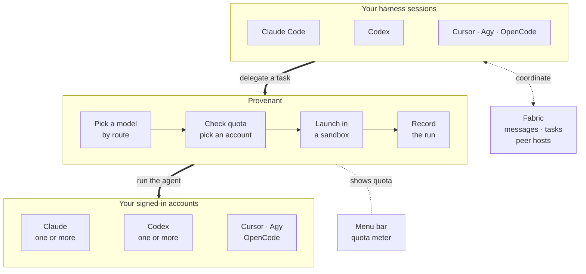
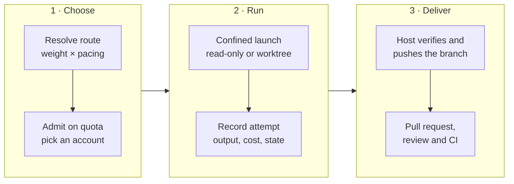

<p align="center">
  <picture>
    <source media="(prefers-color-scheme: dark)" srcset="./assets/brand/provenant-icon-dark.svg">
    
  </picture>
</p>

<h1 align="center">Provenant</h1>

<p align="center">
  Run coding agents from the harness you already use, on the subscriptions you already pay for,
  <br>with quota-aware routing, confined worktrees, full run records and messaging between sessions.
</p>

<p align="center">
  <a href="https://github.com/mblauberg/provenant/actions/workflows/ci.yml"></a>
  <a href="LICENSE"></a>
  <a href="tools/front-door/rust-toolchain.toml"></a>
  
</p>

<p align="center">
  <a href="#why-provenant">Why</a> ·
  <a href="#what-you-get">Features</a> ·
  <a href="#install">Install</a> ·
  <a href="#quick-start">Quick start</a> ·
  <a href="#how-it-works">How it works</a> ·
  <a href="#documentation">Docs</a>
</p>

Provenant lets the coding agent you are already talking to hand work to other
agents safely. From a Claude Code, Codex or other supported session, you ask for
a task to be delegated; Provenant picks a model, checks that one of your
accounts has quota left, runs the agent in a sandbox that can write only to its
own Git worktree (or nowhere, for read-only work), records everything it did and
can push the result to a branch for review.

It is for developers who run several coding agents at once on their own
subscriptions and want that to stay organised: no two agents writing in the same
worktree, no lane started on an exhausted account, and a record of every run.



Each delegated task runs as a **lane**: one agent, one access mode, one record.
**Fabric** is the shared message and task store that lets sessions, and other
machines you configure, coordinate. The `provenant` CLI is a single Rust binary,
and agents reach the same features through its MCP server.

## Why Provenant

Many orchestration tools ask you to describe the work up front as a fixed graph
of steps, or to script each agent's behaviour so every run follows the same
path. That suits work whose shape is known in advance. Coding work often is not:
the right next step depends on what the last one found.

Provenant leaves those decisions with the agents. The session you started stays
in charge and decides what to split, which tier of model to use, how much
review a change needs and when to stop. The harness supplies the parts that
should not depend on judgement:

- **Routing** that spreads work across models and providers by weight and
  remaining quota.
- **Quota** checks before launch, so a lane does not start on an exhausted
  account.
- **Confinement** that fixes what each lane may read and write.
- **Records** of every attempt, its output, cost and final state.
- **Coordination** between sessions through durable messages, tasks and claims.

Fixed task graphs are still available through `provenant fabric graph` when a
job does have a known shape; they are one option, not the frame every task must
fit.

## What you get

| Area | What Provenant does |
| --- | --- |
| **Subscription quota and API** | Drives each provider's own CLI with your existing sign-in, so lanes draw on the subscriptions you already have. Pay-per-token API models are available through OpenCode routes such as OpenRouter; OpenCode's own configuration holds the key, never Provenant. |
| **Many accounts** | Register several accounts per provider. Dispatch resolves an account with headroom unless you pin one, and a quota refusal cools only the account that hit it. |
| **Usage meter** | `provenant quota show` and an optional macOS menu bar app show every account's windows, reset times, credits and staleness in one place. |
| **Your harnesses** | One install wires Fabric MCP, skills and instructions into Claude Code, Codex, Cursor, Agy and OpenCode. Claude Code also gets managed hooks and automatic account switching. |
| **Routing** | Named pools (`utility`, `junior`, `senior`, `principal`, `writing`, `design`) choose among models by weight, scaled by each provider's pacing. |
| **Confined lanes** | Each lane runs `read-only` or `worktree-write` under a macOS sandbox profile. Writers get one registered worktree and no Git credentials. |
| **Host-side delivery** | The host verifies a writer's final commit, pushes it to the branch you name and can open a pull request. |
| **Fabric** | Messages, shared tasks, claims and activity between sessions and agents, plus dispatch to configured peer hosts over SSH. |
| **Records and history** | Every run, task and attempt is stored with its route, account, knobs and output. Lanes can be listed, read, resumed or cancelled later. |
| **Telemetry** | Local cost and token reports, CLI and MCP usage counts, and timeline export for Perfetto, with no collector. |
| **Skills** | 25 workflow skills (scope, implement, code review, diagnose, orchestrate and more) that install into each harness. |

## Requirements

- **macOS** for dispatch. Lanes are confined with the macOS sandbox, and Linux
  has no confinement backend, so it refuses dispatch. CI builds and tests the
  workspace on Linux.
- **Rust 1.99.1**, pinned by
  [`rust-toolchain.toml`](tools/front-door/rust-toolchain.toml), and Git.
- **At least one provider CLI**, installed and signed in: Claude Code, Codex,
  Cursor, Agy or OpenCode.
- **macOS 14 or later and Swift** for the optional
  [menu bar app](apps/quota-menubar/README.md).

## Install

Provenant is built from source; there are no prebuilt releases. These steps
build the binary, stage a release, install it for Claude Code and register one
Claude account.

1. **Build and stage a release.**

   ```sh
   cd tools/front-door
   export PATH="$HOME/.cargo/bin:$PATH"
   CARGO_PARENT="$(mktemp -d)"
   export CARGO_TARGET_DIR="$CARGO_PARENT/cargo-target"
   RELEASE="$(mktemp -d)/release"
   cargo build --release --locked --bin provenant
   cargo run --locked --example package-release -- --out "$RELEASE"
   rm -rf -- "$CARGO_PARENT"
   unset CARGO_TARGET_DIR CARGO_PARENT
   ```

2. **Preview, then apply, the install.** Repeat `--harness` for each of
   `claude`, `codex`, `cursor`, `agy` and `opencode` you use.

   > [!IMPORTANT]
   > Quit Claude Code and the other selected harnesses first. Claude Code
   > rewrites `~/.claude.json` while it runs.

   ```sh
   PROVENANT="$RELEASE/bin/provenant"
   STATE="$HOME/.local/share/provenant/v1"
   "$PROVENANT" --state-dir "$STATE" install --source "$RELEASE" \
     --harness claude --bin-dir "$HOME/.local/bin" --dry-run
   "$PROVENANT" --state-dir "$STATE" install --source "$RELEASE" \
     --harness claude --bin-dir "$HOME/.local/bin"
   "$PROVENANT" --state-dir "$STATE" check install --source "$RELEASE"
   ```

3. **Register your accounts.** Each Claude account lives in its own
   `~/.claude-<label>` directory, signed in separately. Repeat for every
   account, with `--adapter codex` for Codex accounts.

   ```sh
   CLAUDE_CONFIG_DIR=~/.claude-work claude        # sign in, then exit
   provenant accounts register work --adapter claude --directory ~/.claude-work
   provenant quota tick
   ```

<details>
<summary><strong>What the install changes in each harness</strong></summary>

<br>

| Harness | Fabric MCP | Skills | Instructions | Hooks |
| --- | --- | --- | --- | --- |
| Claude Code | `~/.claude.json` | `~/.claude/skills/` | `~/.claude/CLAUDE.md` | `~/.claude/settings.json`, opt-in |
| Codex | `~/.codex/config.toml` | `~/.codex/skills/` | `~/.codex/AGENTS.md` | none |
| Cursor | `~/.cursor/mcp.json` | `~/.cursor/skills/` | none | none |
| Agy | `~/.gemini/config/mcp_config.json` | `~/.gemini/skills/` | `~/.gemini/GEMINI.md` | none |
| OpenCode | `~/.config/opencode/opencode.jsonc` | `~/.config/opencode/skills/` | `~/.config/opencode/AGENTS.md` | none |

Instruction files point each harness at [`HARNESS.md`](HARNESS.md), the runtime
rules agents follow. Managed hooks exist for Claude Code only: they guard risky
shell commands, keep context across compaction and drive account switching. They
are off on first install; `--hooks on` enables them, and a reinstall without
`--hooks` keeps their current state. On macOS the install also manages two
LaunchAgents: one that serves requests from peer hosts and a six-hourly lane
cache clean-up. Remove an integration with `provenant uninstall --harness
<name>`.

The [install runbook](docs/runbooks/install.md) covers release contents,
receipts, migration and recovery.

</details>

## Quick start

Check what Provenant can see. These commands read state only:

```sh
provenant quota show                    # every account's quota windows
provenant route list                    # pools, weights and pacing
provenant route resolve --route junior  # which model a junior lane would get
```

Start a read-only lane:

> [!NOTE]
> This starts a real agent and uses quota on whichever account is chosen.

```sh
printf '%s\n' 'Summarise this repository structure in three bullets.' | \
  provenant dispatch --operation-id "readme-smoke-$(date +%s)" \
    --prompt-stdin --route junior --mode read-only
provenant lanes --all                   # find the attempt
provenant output <attempt>              # read what it wrote
```

A writer lane gets its own worktree, and the host pushes the verified result:

```sh
provenant worktree create fix/example --base origin/main
provenant dispatch --operation-id "fix-$(date +%s)" --prompt-file BRIEF.md \
  --route senior --mode worktree-write --worktree .worktrees/fix-example \
  --deliver-remote origin --deliver-branch fix/example --open-pr
```

Inside a harness, agents do the same through Fabric MCP tools, so in practice
you ask your session to delegate and it dispatches for you. Run
`provenant help <command>` for every flag.

## How it works

Every lane follows the same path. The host makes each decision before launch and
records it, so a lane can be inspected, resumed or audited later.



1. **Choose.** The resolver draws a model from the route's pool, weighting each
   member by its configured weight and its provider's pacing. `pace` compares
   remaining quota with the time left in the window. Admission then picks a
   registered account with headroom.
2. **Run.** The lane starts under a sandbox profile built from its access mode.
   Read-only lanes cannot write; writers write only to their worktree and any
   write roots you grant, and hold no Git credentials. Output, exit state,
   tokens and cost go into the run record.
3. **Deliver.** For a writer, the host fetches before launch and, afterwards,
   verifies the final commit and pushes it with its own Git authority.
   `--open-pr` opens a pull request, and `provenant pr` can watch its CI and
   merge the verified head. How much review a change gets is set by the
   [review ladder](HARNESS.md) and the `review.*` knobs.

Fabric runs alongside this path. Sessions on one machine, or on peer hosts,
exchange messages, share tasks and claim work, so two harnesses can split a job
without stepping on each other. See the
[architecture overview](docs/ARCHITECTURE.md) for the crate map and state layout.

## Customise

Settings, routes and accounts live in one validated file, `config.toml` in the
state root (`~/.local/share/provenant/v1` by default), and the CLI edits it.

```sh
provenant config set profile economy                    # balanced, economy or rigorous
provenant config set lanes.max_concurrency 4            # or override per run with --knob
provenant route set senior claude/claude-sonnet-5-5 --weight 6
provenant route pacing codex spend                      # pace, spend or max
provenant route reset senior                            # back to the bundled pool
```

- **Profiles and knobs** set lane concurrency, nesting depth, review strength
  and more. `provenant config show` lists each value and where it came from, and
  every attempt records the knobs it ran with.
- **Routes** are yours to reshape: add models, change weights or pin an exact
  model with `--model`. `--confidential` excludes models that train on input
  or are unclassified.
- **Accounts** take an optional plan, priority and billing anchor, and the
  menu bar app lets you rename, reorder or hide them.
- **Claude Code account switching** is opt-in. When the current account passes
  a quota threshold, a managed hook checkpoints the session and continues it in
  a fresh session on an allowed account with headroom.

## Telemetry and history

Reports are built from records on your machine; no collector or upload is
involved. Usage counters never log arguments, prompts or results.

| Command | Shows |
| --- | --- |
| `provenant telemetry stats` | Tokens and cost by run and attempt, priced from [`config/telemetry-prices.toml`](config/telemetry-prices.toml) |
| `provenant telemetry stats --usage` | How often each CLI verb and MCP tool is used, including installed ones never called |
| `provenant telemetry trace` | A timeline of attempts across hosts, for [Perfetto](https://ui.perfetto.dev) |
| `provenant lanes --all` | Every lane and its state; `--id` shows one attempt's route, account and grants |
| `provenant output <attempt>` | A lane's recorded output |
| `provenant resume <attempt>` | Continue an attempt with a new prompt |
| `provenant workflow session` | Save, show or hand off a session checkpoint |

Use these to tune your setup with evidence: shift route weights towards models
whose lanes succeed, spot commands and MCP tools nobody calls, and see where
quota actually goes. The `retrospect` and `evaluate` skills help turn what you
find into process changes and repeatable evaluations.

## Documentation

| Document | Covers |
| --- | --- |
| [Architecture](docs/ARCHITECTURE.md) | Components, crate map, state root and lifecycle |
| [`HARNESS.md`](HARNESS.md) | The runtime rules agents follow, including the review ladder |
| [Specifications](docs/specs/README.md) | Contracts for each subsystem |
| [Install](docs/runbooks/install.md) | Build, package, install, uninstall and Fabric MCP |
| [Configuration](docs/runbooks/configuration.md) | Profiles, knobs, quota display and account switching |
| [Model routing](docs/runbooks/model-routing.md) | Pools, weights and pacing |
| [Providers](docs/runbooks/providers.md) | Launch notes for each provider |
| [Fabric hosts](docs/runbooks/fabric-hosts.md) | Peer hosts and remote dispatch |
| [Worktrees](docs/worktrees.md) | Worktree policy and writer dispatch |
| [Telemetry](docs/runbooks/telemetry.md) | Usage, cost and trace export |
| [Quota menu bar](apps/quota-menubar/README.md) | Build and run the macOS app |
| [Skills](skills/) | The workflow skills installed into each harness |
| [Glossary](docs/glossary.md) | Terms used across the docs |

## Contributing

Read [`AGENTS.md`](AGENTS.md) for repository-wide instructions,
[`MAINTAINING.md`](MAINTAINING.md) for the change process and the
[GitHub workflow](docs/runbooks/github-workflow.md) for branches, issues and
delivery. Rust code lives under [`tools/front-door/`](tools/front-door); keep a
change inside the crate that owns it, and follow the accepted specification
before changing a public command or record. CI runs the full checks on every
pull request.

## Security

Report vulnerabilities privately through
[GitHub private vulnerability reporting](https://github.com/mblauberg/provenant/security/advisories/new).
[`SECURITY.md`](SECURITY.md) covers scope and safe use.

## Licence

Released under the [MIT licence](LICENSE). Third-party components are listed in
[`THIRD_PARTY_NOTICES.md`](THIRD_PARTY_NOTICES.md).
