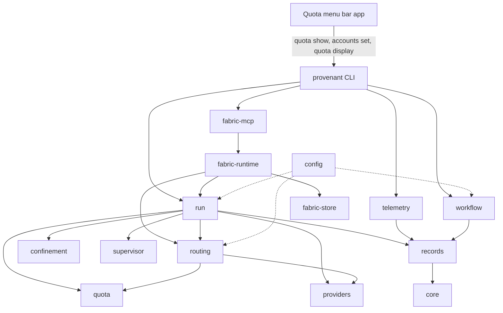

# Provenant architecture

## Purpose

Provenant is an agent harness: a gated delivery lifecycle for coding agents.
This repository is an operating system for agent work, not a prompt collection.
It implements a general agentic SDLC that can be used for software, research,
analysis, documentation and other evidence-bearing work. The objective is
quality per user attention-hour: agents create depth and verification; users
retain scarce judgement at consequential gates.

`GLOBAL-AGENTS.md` is the global bootstrap, installed as `AGENTS.md`.
`HARNESS.md` is the compact runtime constitution. Skills load procedural depth only when triggered.
This document preserves the design intent so future maintainers can change the
harness without rediscovering it from individual skills.

## System map

The `provenant` binary is the CLI and composition edge. The
[workspace policy](specs/rust-workspace.md#crate-layering) owns allowed crate
dependencies; manifests own the declared members and edges.

The diagram shows conceptual execution flow; arrows are not crate dependency declarations.

## Trust boundaries

The [constitution](../HARNESS.md) owns lifecycle, risk, review independence,
authority and user gates. Skills own the procedures. The architecture separates
three kinds of evidence:

- Run records describe execution, route lineage, custody and observed outcomes.
- Workflow receipts bind a subject, authors, risk, review attempts and a delivery
  decision. They do not contain typed verification, evaluation, release or
  observation gate records. The record owner is
  [`workflow.rs#DeliveryReceipt`](../tools/front-door/crates/records/src/workflow.rs).
- Release evidence proves an authorised external action against its target;
  an accepted delivery does not grant that authority.

CLI and Fabric MCP use the same execution services. Confinement compiles the
host-derived access plan, providers prepare launches, supervisor owns process
custody, and run owns attempts and terminal evidence. Neither the transport nor
the provider's success certifies delivery acceptance. See
[ADR 0021](adr/0021-configured-workspace-dispatch-boundaries.md) and
[ADR 0022](adr/0022-thin-fabric-mcp-execution-facade.md).

A graph coordinates attempts and deterministic actions through one patch and
checkpoint owner. Replay prevents duplicate launches. Children undergo ordinary
host admission; their sandbox may differ from the parent's, but delegation
cannot widen the user-approved authority envelope. Peer hosts retain their own
custody and journals. [ADR 0039](adr/0039-graph-of-templates.md) owns that boundary.

Machine-local layout belongs to the [state spec](specs/state.md). Shared-worktree
ownership belongs to [worktrees.md](worktrees.md); worktrees isolate writers but
do not grant authority. Durable project knowledge stays in shared project docs;
private harness memory follows the constitution.

## Routing, adapters and receipts

The Rust router separates route policy from execution. The catalogue at
`tools/front-door/crates/routing/assets/catalogue.toml` defines named weighted
pools. `provenant-routing` combines those weights with provider pacing and
eligibility; `provenant-quota` supplies account quota status and admission
decisions. `provenant-run` owns dispatch and records the resolved route and
provider result. `provenant-providers` owns the adapter registry and native wire forms.

The [routing spec](specs/routing.md) owns selection and fallback intent; the
`provenant help --all` owns operator interfaces.

Run records retain requested and resolved model identity, effort, and any
fallback substitution.

## Release and managed installation

The `provenant-config` crate owns release identity and managed-file rules. It stamps the workspace source, packages a typed `release.json`,
verifies its bytes and modes, then installs into the immutable
`<state>/releases/<SourceDigest>/` directory. Under the install lock it applies
managed entries and publishes the single `<state>/install/receipt.json` last.

Installation is idempotent across an interrupted receipt publication. Managed
ownership never authorises overwriting unrelated files or uninstalling changed
user content. The [install runbook](runbooks/install.md) owns operations.
Product files, instance-owned files and machine-local derived state retain
separate ownership under [ADR 0019](adr/0019-installed-file-class-ownership.md).

## Design constraints for maintainers

- Keep `GLOBAL-AGENTS.md` and `HARNESS.md` small enough to load every session.
- Put operational detail in skill references and executable checks.
- Keep model identities in routing data, not scattered prose or shell cases.
- Make optional providers additive and non-blocking.
- Prefer explicit receipts over raw transcripts or hidden memory.
- Promote only a clear reusable trigger, artifact, fixture and ownership
  boundary; keep limited evidence opt-in and provisional, and project policy
  local.
- Test failure modes that were observed in real runs, including Herdr transport,
  provider limits, context churn and partial review artifacts.
