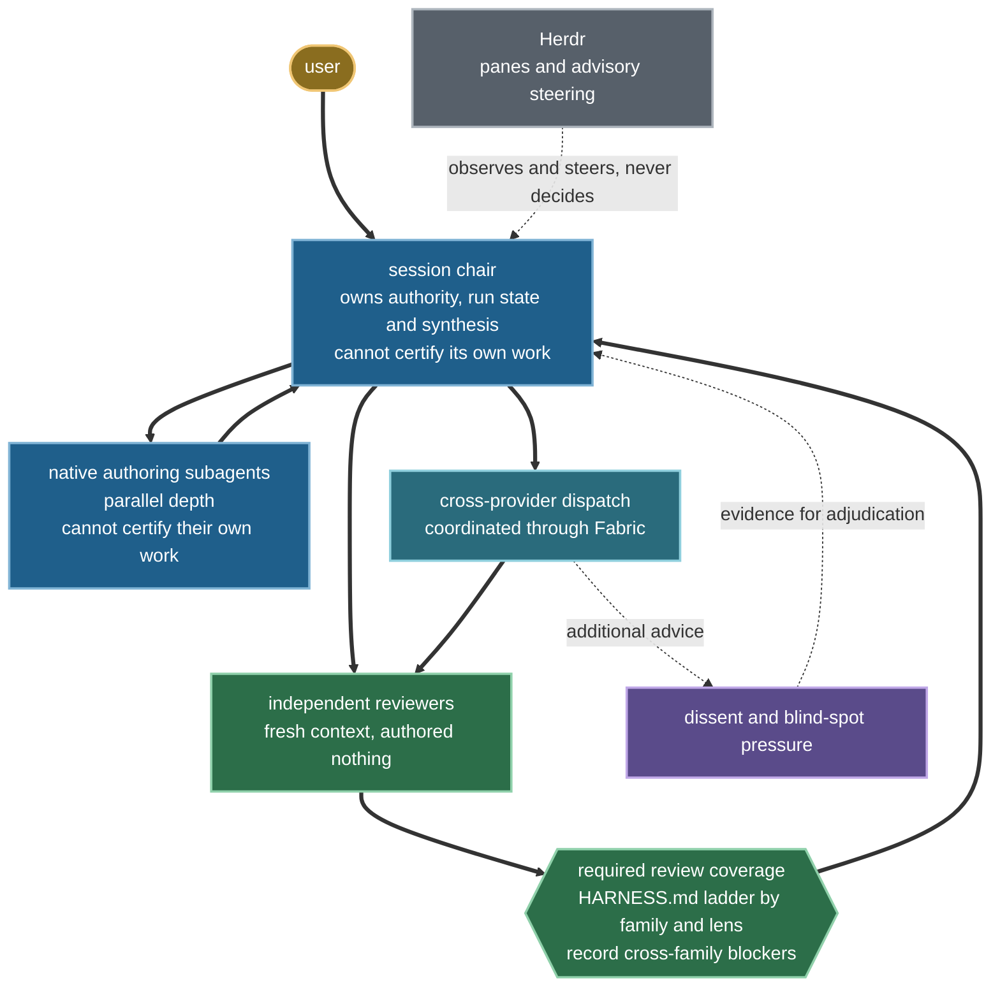

# Provenant architecture

Fabric v2 run layout, tool contract, provenance and cleanup decisions are
recorded in [Fabric v2](specs/fabric-v2.md).

## Purpose

Provenant is an agent harness: a gated delivery lifecycle for coding agents.
This repository is an operating system for agent work, not a prompt collection.
It implements a general agentic SDLC that can be used for software, research,
analysis, documentation and other evidence-bearing work. The objective is
quality per user attention-hour: agents create depth and verification; users
retain scarce judgement at consequential gates.

`AGENTS.md` is the tiny bootstrap every operator sees. `HARNESS.md` is the
compact runtime constitution. Skills load procedural depth only when triggered.
This document preserves the design intent so future maintainers can change the
harness without rediscovering it from individual skills.

## Lifecycle and user gates

Review pressure follows the [`HARNESS.md` Review ladder](../HARNESS.md#review-ladder).
Routine work uses the chair and objective checks. Substantial work adds one
independent cross-family review when available. Crucial work requires two passing
independent reviews with distinct lenses and two non-chair families when
available. Terminal work adds an adversarial lens to crucial coverage. The
shared ladder checker enforces this coverage for delivery and orchestration
receipts, including the recorded-blocker fallback.

Gold gates reserve scope and one-way doors, any required explicit acceptance,
and external-action authority for the user. Objective checks and tier-required
review meet delivery acceptance; the chair reports the outcome and the user
may still reject it. Explicit user acceptance is required only for `terminal`
work or when the approved scope asks for it. A project may name its landing
gate as acceptance (Sealle: landing is acceptance for everything).

The tier is derived rather than declared. `scope` rates every factor in
`config/risk-policy.json`, the highest tier any rating maps to is the run's
minimum tier, and a lower declared tier needs a user-approved override carrying
an approver, a reason and evidence. The table between the markers records the
current policy and is maintained with that source file. Internal data alone
leaves the minimum tier routine: consequence factors such as reversibility,
external effects and critical surface raise it. Disclosure is scoped
separately; pass `confidential: true` (`--confidential`) to keep content off
free and prompt-training routes.

<!-- risk-factor-table:start -->

| Factor | `routine` | `substantial` | `crucial` | `terminal` |
|---|---|---|---|---|
| blast radius | `local` | `multi-module` | `shared-system` | `production` |
| reversibility | `easy` | `moderate` | `hard` | `irreversible` |
| data sensitivity | `public`, `internal` |  | `confidential` | `regulated` |
| migration | `none` | `reversible` | `stateful` | `destructive` |
| oracle quality | `strong` | `mixed` | `weak` |  |
| external effects | `none` |  | `reversible` | `irreversible` |
| critical surface | `none` | `public-contract` | `auth-security`, `privacy`, `financial`, `legal`, `build-release-gate` | `life-safety` |

<!-- risk-factor-table:end -->

One palette carries the whole document. Every diagram below uses it, and no
colour means two things:

| Colour | Meaning |
|---|---|
| Gold | a user decides here |
| Green | a blocking leg: it can stop the run |
| Purple | an advisory leg: it never blocks, and a skipped leg is recorded |
| Blue | a participant that authors or decides, and so may never certify |
| Teal | transport |
| Red | an interrupt: it suspends a run, and recovery resumes the interrupted state |
| Grey | inert: stopped, closed, or observing only |

Green covers `verify`, `evaluate` and the independent review coverage required
by the tier, because each can stop a run. Purple marks additional advisory
pressure beyond the required coverage; a provider family's role depends on the
run's ladder rather than a fixed colour.

```mermaid
flowchart TB
    accTitle: The full delivery lifecycle and its user gates
    accDescr: Session prepares context and scope produces the specification, risk tier and authority. A user gate approves the specification or sends it back to scope. Inside the deliver kernel, execute runs implement, tdd, refactor or diagnose, then deterministic verification runs, then a separate conditional evaluate gate runs only when behaviour is stochastic or judgement bearing, then independent review runs in fresh contexts that never authored the work. Coverage follows the HARNESS.md Review ladder, with an adversarial lens added at terminal. A failed check or blocking finding returns to execute under the risk-tier repair budget: routine 2 cycles, substantial 4, and crucial and terminal 5, a guardrail against unbounded loops, not a target. Objective checks and tier-required review meet acceptance, or a project may name its landing gate. Explicit user acceptance is required only for terminal work or approved scope. The chair reports the outcome and the user may reject it. Any external action needs a separate user authorisation before release and observation. A failed observation opens diagnose. Every path that returns work to scope, a structural review finding, a rescope at the acceptance gate, diagnostic evidence and the retrospect flywheel, converges on one back-to-scope collector rather than five separate return edges.
    SE(["session"]) --> SC["scope<br/>spec, risk tier, authority"]
    SC --> G1{{"USER GATE<br/>approve spec, risk tier, one-way doors"}}
    G1 -. "send back" .-> SC
    G1 == "authority" ==> DEL

    subgraph DEL["deliver kernel: one delivery-run receipt binds every gate below"]
      direction TB
      EX["execute<br/>implement, tdd, refactor, diagnose"] --> VF["verify<br/>deterministic checks"]
      VF -. "failed" .-> EX
      VF --> Q{"behaviour stochastic<br/>or judgement bearing?"}
      Q -- "no" --> RV
      Q == "yes" ==> EV["evaluate<br/>repeatable judgement gate"]
      EV -. "failed" .-> EX
      EV --> RV["review<br/>independent, fresh context<br/>risk-scaled HARNESS.md ladder"]
      RV -. "repair by tier: routine 2, substantial 4, crucial/terminal 5" .-> EX
    end

    RV --> AC["acceptance<br/>checks + required review or project landing"]
    AC --> Q2{"terminal or explicit acceptance<br/>required by approved scope?"}
    Q2 -- "yes" --> G2{{"USER GATE<br/>explicit acceptance"}}
    Q2 -- "no" --> OUT["chair reports outcome"]
    G2 -- "accept" --> OUT
    G2 -. "stop" .-> HALT(["stop"])
    OUT --> RT["retrospect"]
    OUT == "external action" ==> G3{{"USER GATE<br/>authorise the external action"}}
    G3 --> RL["release and observe"]
    RL -. "observation failed" .-> DG["diagnose"]
    RL --> RT

    RV -. "structural finding" .-> RS
    G2 -. "rescope" .-> RS
    DG -. "evidence" .-> RS
    RT == "flywheel: next cycle" ==> RS
    RS(["back to scope"]) ==> SC

    classDef user fill:#8a6d1f,stroke:#f0c674,color:#ffffff,stroke-width:2px
    classDef blocking fill:#2c6e49,stroke:#8fd0aa,color:#ffffff,stroke-width:2px
    classDef inert fill:#57606a,stroke:#adb5bd,color:#ffffff,stroke-width:2px
    class G1,G3 user
    class G2 blocking
    class VF,EV,RV blocking
    class HALT inert
    style DEL fill:none,stroke:#6e7781,stroke-width:1px
```

Four paths return work to `scope`: a structural review finding, a rescope at the
acceptance gate, evidence from a failed observation, and the retrospect
flywheel. They converge on one `back to scope` collector so the picture carries
one return edge into `scope` instead of five crossing the canvas.

Two orderings in that picture are load-bearing. Deterministic verification runs
first and always. `evaluate` is a separate conditional gate that runs only when
behaviour is stochastic or judgement bearing, so deterministic checks come
before judgement and the two are never fused into one box. Review is independent:
reviewers never author the surface they certify. A receipt reaching acceptance
without its tier's passing review coverage, or without a reasoned blocker when
cross-family coverage is unavailable, fails the machine gate. Failed legs count
as neither reviews nor blocker records.

The lifecycle loops. A failed check returns to execution; a structural review
finding may return to scope; production evidence may open a diagnosis and a new
implementation run. `retrospect` closes the quality flywheel by benchmarking
the completed trajectory, clustering root causes, proposing small
evidence-backed harness changes, adding regression gates and monitoring the
next comparable run. It promotes durable learning into canonical project docs
instead of accumulating retrospective logs. `autopilot` adds crash-safe
persistence for genuinely sprawling run-until-STOP work, but does not replace
the ordinary delivery loop.

User approval is required for:

- the specification and unresolved acceptance criteria;
- one-way-door architecture and risk-tier downgrades;
- destructive, irreversible or externally visible actions;
- external communications and production promotion;
- final acceptance for `terminal` work or when the approved scope asks for it.

Routine reversible implementation inside approved authority does not need a
stream of micro-approvals.

## Neutral delivery kernel

`deliver` is the cross-domain lifecycle front door and `delivery-run` schema v1
is its portable receipt. Scoped criteria belong in the PR or skill document.
Evaluate and domain skills
own repetition protocols, source-authority, privacy and qualified-review evidence;
explicit user approval duties remain in force.

`RUN.json` is a flat record, not a state machine. It holds what the run did:
the approved intent and design, the authority envelope, the declared artifacts
and their digests, the evidence, the reviews, the security and observation
contracts, and the human gates. `skills/deliver/scripts/delivery_run_shape.py`
declares the field set and its types, and both the producer
(`delivery_receipt.py`) and the reader (`validate_delivery.py`) check every
receipt against it, so a receipt cannot be written in a shape the reader
rejects.

Ordering is not certified, because a receipt cannot certify its own history:
the agent that writes the transitions writes the receipt in the same turn. What
is checked is what each recorded gate demands. The current schema still uses
`human_gates.acceptance` for explicit user approval; this retained code contract
is catalogued in [issue #1025](https://github.com/mblauberg/provenant/issues/1025) and
must not be auto-approved from checks. Human acceptance recorded as
approved requires the profile's deterministic and judgement evidence, the
review ladder, the security surfaces and the measures to be present and
passing. Release approval requires acceptance. A closed run, meaning release
approved with a settled observation, requires a passing observation inside its
declared window and, where risk or incident policy says so, a closed
retrospective. `repair_cycles` is a counter the producer increments, bounded by
the risk tier.

A digest-bound project policy may add a complete profile or add evidence and
measure gates to a built-in profile. Global minima load first and cannot be
removed or reclassified by the project overlay.

The kernel binds approved intent, design, authority, artifacts, deterministic
and judgement evidence, review independence, acceptance, release, observation
and retrospective linkage. Domain skills own methods; the kernel owns state
and proof. `implement` remains the software front door and uses the same
canonical receipt; there is no parallel implementation schema or adapter.
Passing deterministic evidence binds its declared, live-hash-verified artifact;
a syntactically valid digest or exit code alone is not proof.

Software execution composes bounded techniques rather than duplicating
lifecycle owners: `tdd` for new or changed observable behaviour, `refactor` for
approved behaviour-preserving structural work, and `diagnose` when root cause is
unknown. `code-review` remains source-read-only and independent. SOLID,
information hiding, cohesion, coupling, simplicity, idempotency and similar
principles are hypothesis generators; a finding still needs a concrete failure
mechanism, impact, evidence and validation route.

Frontend authority is similarly split: `ui-ux-design`'s design/make branch
supplies authorised design mutation methods inside `implement`, while its
review branch owns read-only UX, visual, accessibility and responsive
evidence. `scope` owns the
design decision and `engineering-docs` owns canonical placement.

`release` promotes one digest- or Git-revision-bound, accepted artifact through a separately
authorised `deploy`, `publish`, `share`, `send` or `activate` action. Targets are
typed as environments, recipients or audiences; execution may use an approved
command, connector or named user operation. Completion requires target-visible
proof and an observation/reversal contract; a successful command by itself is
not proof.

## Equal primaries, accountable ownership

Claude Code and Codex are equal primary orchestrators. Whichever harness the
user starts is the session chair and owns authority, user communication, run
state and synthesis. It may combine native same-family subagents for parallel
authoring with fresh independent reviewers for the tier's required coverage.
The chair and authoring subagents cannot certify their own work. Independent
reviews count by provider family and lens rather than receipt role.

Every passing review needs a non-blank lens and a distinct reviewer. When required
cross-family coverage is unavailable, each missing non-chair family records an
unavailable or omitted leg with a non-empty reason and receives an independent
same-family replacement. At crucial and terminal risk, fallback still needs two
passing reviews with distinct lens sets covering at least two lenses. A blocker
for the chair's family or an already passing family supplies no missing-family
coverage. A failed leg supplies neither coverage nor a blocker record. Projects
may set their own ladders while retaining the constitution's minimum independence.

Provider-backed external workers, including the other primary and
distinct families, are dispatched through Fabric MCP or the direct command
line. Both front doors delegate to the same `orchestrate` owners; Fabric does
not implement provider mechanics. Dispatching a worker and claiming
independence are separate things: ordinary dispatch records that it makes no
independence claim, and the Fabric MCP execution tools reject an assurance
selector as a typed input error, so a review leg that must carry an
independence claim runs the assurance path in
`skills/orchestrate/scripts/cf_dispatch.py` ([ADR
0021](adr/0021-configured-workspace-dispatch-boundaries.md), [ADR
0022](adr/0022-thin-fabric-mcp-execution-facade.md)).

The picture below separates authorship, required review and additional advice.

Solid legs carry required coverage; dashed legs supply additional advice.
`validate_delivery.py` also requires each review row to declare
`independent_of_authorship: true`, but does not bind the certifier's agent
identity to authorship or decision custody. Validator success therefore proves
declared topology and family separation, not actor-level independence. Policy
still disqualifies the chair and authoring subagents from certifying their own
work. Herdr sits outside the decision path entirely.

Paired-primary mode lets Claude and Codex rotate stage ownership, coordinated
through Fabric, which carries the messages, shared tasks and activity log
between them.
It still has one chair and one active owner per stage, namespaced artifacts and
non-overlapping write scopes. Pane transcripts are transport, not durable state.
Pi is dormant by default until its provider, economics, permissions and receipt
quality are deliberately accepted.

## Routing, adapters and receipts

The router separates policy from execution:

- `config/model-routing.json` describes families, aliases and fallbacks;
- `scripts/model-route` resolves a role from runtime capabilities;
- adapter scripts execute the resolved route;
- receipts record requested and actual identity, effort and substitutions.

`principal`, `senior` and `junior` are capability aliases, not permanent jobs
for a vendor. Opus is the default Claude principal. The catalogue may configure
one bounded override occupant per risk tier. Each configured occupant is
reserved for that tier's roles, alias and effort ceiling. Runtime discovery,
not this document, determines effort support and current availability.
Lifecycle risk stays in delivery and dispatch receipts. Selecting a configured
override occupant requires the separate explicit model-override input; ordinary
risk metadata cannot change a route.

Task-class routes use the resolver's policy-owned alias and effort. Codex and
Agy produce fresh model snapshots before final resolution. Claude first
resolves that alias and effort, runs its bounded canary, then resolves with the
snapshot. The shell does not duplicate the model or task-class catalogue.

## Review as a council, not a vote

The review system borrows the useful parts of council-style workflows:
independent first passes, deliberately different lenses, anonymised challenge
where anchoring matters, and a fresh reducer that adjudicates against evidence.
It rejects majority voting and repetitive reviewers.

The review lead chooses lenses proportional to the work: correctness, security,
performance, reliability/concurrency, state and type boundaries, test coverage,
spec alignment, readability/maintainability and larger structural
simplification. Findings become blocking only when evidence and primary-family
corroboration justify it.

## Authority and concurrency

Authority is a machine-readable envelope: allowed source and artifact paths,
prohibited paths/actions, disclosure, secrets, deployment, irreversible
actions, expiry and approver. Delegation may only narrow it.

There is no overlapping concurrent source writing. Partition ownership, use
artifact-only workers, or have one serial integrator apply patches. Worktrees
are visibility and isolation aids, not permission boundaries; their shared
location and lifecycle are defined in [worktrees.md](worktrees.md).

## Context and durable memory

Project knowledge must remain visible to every family. Durable facts therefore
live in specifications, ADRs ([adr/](adr/)), runbooks and context digests.
Private harness memory is limited to cross-project user preferences. For this
repository, the `Repository process` declaration names the scope/story and
workflow-state owners: GitHub issues own the current owner, dependencies and
user gates; Project Status owns workflow state. Other repositories declare
their own owners. A project-local effort map exists only for a declared
project-docs, unavailable-tracker or cross-tracker route; it never mirrors live
work. Retention follows project and risk policy plus bounded run-artifact rules.
No canonical backlog contract, cross-store migration or god manifest is
introduced. The governing decisions are recorded in the [ADR index](adr/README.md).

Workers return compressed findings and artifact paths. Session hygiene checks
freshness, size, duplication, stale logs, scratch manifests and handoff quality.
Pruning is conservative: delete only proven run-owned ephemeral data, compact
rather than blindly append, and merge or split curated documents when their
retrieval cost signals demand it. Sibling `.worktrees` are protected and
excluded from context scans.

## Managed installation

`scripts/manage_installation.py` plans, checks, installs, reconciles and removes
only harness-owned skill links. Every normal install repairs missing or stale
managed links and retires safe managed leftovers. It also retires links still
recorded by the former Claude custom-agent receipt during the first upgrade.
A versioned manifest records current ownership, source tree digests and the
bound target beside the
target skills directory. The post-install integrity check verifies catalogue
presence. Missing or noncanonical required names fail; extra symlinks resolving
outside the canonical skill tree produce warnings. Unmanaged paths are never
claimed, overwritten or automatically removed; changed managed targets fail for
user resolution. A staged temporary link is atomically replaced into place
before the manifest is written; rerunning the installer reconciles any partial
result.
The managed catalogue is the skills plus the `skills/_shared` library they
import. A per-entry layout links and receipt-tracks that library like any skill,
so an installed target root is a sufficient import root. A whole-directory
projection already exposes it and keeps no manifest at all.
Instance-owned `custom-skills/` entries join the per-entry projection without
becoming product-managed manifest entries. A whole-directory link has nowhere
to hang one, so the first install that carries any custom skill converts that
target, once, into per-entry links for the product catalogue and the custom
entries together, and writes the receipt the per-entry layout already keeps. A
target with no custom skill keeps the whole-directory link. Later installs see
a per-entry layout and reconcile it normally, so the conversion is idempotent
and a custom link is retired when its source disappears. Their machine-local link records
contain source paths but no content digest: installation discovers names and
links directories without validating third-party content. Product resources
used by a linked skill remain addressed through `AGENTS_HOME`, which must name
the product root; helpers that resolve their own symlink may derive the same
root directly. A product and instance skill with the same name fails before
the target directory or installation receipt is mutated.
Provider bootstraps remain small and share the same precedence sentence.

`ui-ux-design` retains UI judgement and read-only review guidance. Browser
inspection uses the optional `playwright` skill and the target app's own dev
server. Provenant owns no UI runtime, detector, overlay, source injection or
UI session store. Browser evidence is untested when no authorised browser is
available; the tool is never downloaded implicitly.

Every installed file has one owner: a product-shipped projection, an
instance-owned file, or a product template seeded once and instance-owned
thereafter. Machine-local derived state is the fourth class and belongs to
neither repository ([ADR 0019](adr/0019-installed-file-class-ownership.md)).
`scripts/instance_installation.py` owns the instance side. It writes the
path-free, committable desired state at `config/installation.json`: product
name, version and install mode, `fused` when the instance root and product root
are one tree, which is why the product repository tracks no copy of its own. It
seeds `AGENTS.md`, `config/model-preferences.json` and
`config/model-routing.json` only when they are absent, and a later install
rewrites neither the desired state nor a seeded file, leaving Git as the drift
detector. Machine-local state holds the installation receipt, with absolute
target roots and digests for one machine, and `.agent-fabric/product-root.json`,
the pointer to this machine's product checkout rewritten on every install so
that committed instance state never carries an absolute machine path.
Split-layout startup binds the product root for shipped runtime and
compatibility owners and `${AGENTS_HOME}`; the instance root owns its seeded
routing and preference configuration.

The canonical skill catalogue is also a constrained interface. Every skill has
balanced positive, negative and boundary routes; descriptions place the trigger
and nearest exclusion early and the complete rendered catalogue stays inside
the provider discovery budget. A skill carries occasional judgement-rich
procedure, a script/hook enforces deterministic policy, an MCP/app adds an
external capability, and a plugin distributes a stable coherent bundle. Public
packs are research inputs, not wholesale imports.

## Completion evidence

Substantial runs record risk and authority, chair/stage ownership, actual model
lineage, checks and evals, reviewer independence, repair cycles, disagreements,
degradation, retained artifacts and user-gate state. Deterministic checks come
before judgement. A fluent answer without trajectory evidence is not complete.

## Design constraints for maintainers

- Keep `AGENTS.md` and `HARNESS.md` small enough to load every session.
- Put operational detail in skill references and executable checks.
- Keep model identities in routing data, not scattered prose or shell cases.
- Make optional providers additive and non-blocking.
- Prefer explicit receipts over raw transcripts or hidden memory.
- Promote only a clear reusable trigger, artifact, fixture and ownership
  boundary; keep limited evidence opt-in and provisional, and project policy
  local.
- Test failure modes that were observed in real runs, including Herdr transport,
  provider limits, context churn and partial review artifacts.
