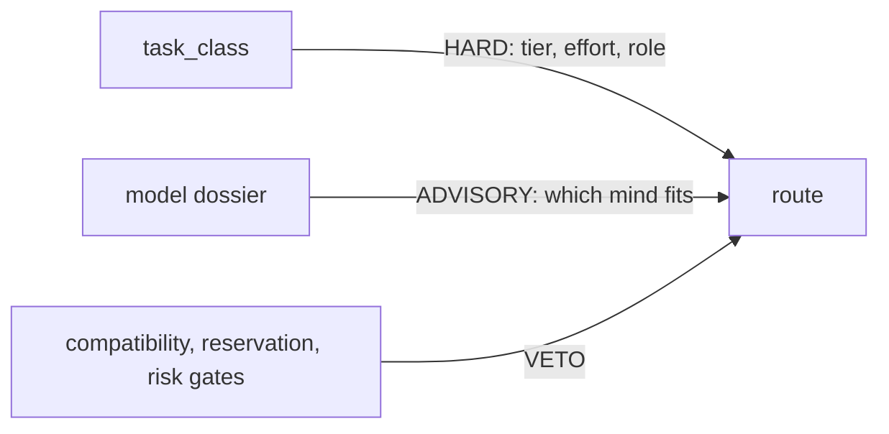

# Model dossier (advisory)

This file describes what each model is *like*, and records the standing
preferences that follow from it, so an orchestrator choosing between two
admissible routes can choose on judgement instead of looking a case up in a
table. It is the harness's opinion of the minds, not its rules about routing.

**The entries below are examples, not an enumeration.** Most real dispatch
decisions are not written here and never will be. Read the entries, form a view
of the models, then reason about the task in front of you. A task whose
character is absent is the normal case, not an error: reason from the nearest
entries and say which ones you reasoned from.

Read it before choosing a model. Prefer what it says. Depart from it when the
work calls for something else, and say why in the receipt.

## Advisory only

This file cannot change what is permitted. Nothing here is enforced by a schema
or a gate, and no script parses this file. It exists so preferences can be
written in a sentence, changed in a sentence, and read by whoever is about to
dispatch a leg.

- `task_class` decides tier, effort and role. Compatibility, reservation and
  risk gates decide admissibility. Both keep every bit of their current
  authority.
- The dossier only ranks options that are *already* admissible. It never widens
  authority, never reaches a disabled adapter, never overrides a reservation,
  tier or compatibility gate, and never blocks a dispatch.
- If a preference here disagrees with a resolved route, the resolved route wins
  and the disagreement is a signal to fix the dossier, not the router.

## What this file does not own

| Content | Owner |
|---|---|
| Task classes, tiers, roles, efforts, degradation policy | `orchestrate` skill, routing reference |
| Route catalogue, resolution and receipt behaviour | `provenant route list` and `provenant route resolve` |
| Review-pressure ladder and risk tiers | `HARNESS.md` |
| Correlated-error caveat on cross-family review | `orchestrate` skill, routing reference |

Nothing above is restated here. If you want to know what a route *must* be, read
those. This file only helps you pick among what they already allow.

### Checking the live catalogue

The bundled Rust catalogue owns route availability and resolution. Use
`provenant route list` to inspect named routes and `provenant route resolve`
to check a route or exact model. This dossier records advisory preferences;
it does not set aliases, weights, activation gates or admissibility.

For numbers rather than judgement, see the
[model benchmark registry](research/model-benchmarks/README.md): published
scores, costs and the frontier effort range per model. Those are priors only
and never override a replay-bench or golden-task result.

## Entry format

Loose by design. An entry is a heading plus whatever labelled lines are worth
writing: `Good at`, `Watch out for`, `Cost`, `Reach`, or anything else that
turns out to matter. Nothing parses this file, so an unrecognised label, a new
model, a new category or a whole new provider is a plain text edit, with no code
change, no test to update and no schema to extend.

Where a field is blank, it is blank because nobody has recorded a view yet. Do
not read an absent `Watch out for` as an endorsement.

## Models

### Opus 5.5 (Anthropic principal)

- **Good at:** chairing, orchestration, hard reasoning and open-ended
  exploration. The default for critical review, synthesis and adjudication at
  every risk tier, ahead of Fable 5.1. Reserve it for that work; Sonnet 5.5 is
  the cheaper default elsewhere.
- **Watch out for:** the owner on Opus 5's long-form prose: "opus's writing is
  quite horrible". Hand human-facing prose to a voice pass (see
  [Human-facing final polish](#human-facing-final-polish)) rather than shipping
  Opus drafts as written.
- **Cost:** principal-tier; not separately characterised.
- **Reach:** the `opus` alias, which resolves to `claude-opus-5-5` (verified
  2026-09-23 from `modelUsage`). `claude` adapter, `anthropic` family; the `agy`
  adapter carries older Opus builds only.

### Claude Fable 5.1 (Anthropic override)

- **Good at:** a deliberately different Anthropic mind for synthesis or
  adjudication when Opus has already had its say.
- **Watch out for:** the owner prefers Opus 5.5 for critical work most of the
  time, and in September said "no fable at the moment". Reach for Fable only
  when asked, or when a second Anthropic perspective is the point. Effort is
  capped at `medium` by the catalogue override.
- **Cost:** not recorded.
- **Reach:** `claude-fable-5-1` through the crucial and terminal
  `--model-override-tier`, synthesis and adjudication roles only.

### GPT-6 Astra (OpenAI principal)

- **Good at:** the hard, high-stakes slice: correctness, edge cases and precise
  work on a tight scope.
- **Watch out for:** no standing behavioural note yet. Keep the brief tight and
  record new evidence rather than carrying GPT-5.6 Sol's profile forward by
  assumption.
- **Cost:** principal-tier.
- **Reach:** `codex` adapter (preferred), `openai` family. The native Codex app
  exposes `low` through `ultra`; the Responses API supports through `max`.
  Treat those as separate surfaces and probe the CLI before dispatch.

### GPT-6.1 Sol (OpenAI senior)

- **Good at:** Codex senior tasks: ordinary implementation, research
  legwork, review and drafting that need more judgement than bulk extraction
  but do not justify Astra. Very cheap for its strength.
- **Watch out for:** new on 2026-09-23; no field record yet. Record what you see.
- **Cost:** cheap.
- **Reach:** `codex` adapter, `openai` family, first `senior` candidate (Luna is its fallback), at
  `high` by default; `low` through `ultra` in the Codex CLI (0.155.1+).

### GPT-6 Luna (OpenAI junior)

- **Good at:** cheap, high-token legwork and mechanical slices, and fan-out
  where several bounded opinions are worth more than one principal call.
- **Watch out for:** the owner on its predecessor, GPT-5.6 Luna: "codex astra is
  better at design and motion than luna - luna isn't great", and it could
  over-engineer a loose brief. Keep briefs tight and keep design work off it
  until GPT-6 Luna has its own record.
- **Cost:** very cheap; the point of using it. The owner's standing wish is
  "use just luna or some of the opencode models for smaller
  implementation/fixes instead of loading up astra".
- **Reach:** `codex` adapter, `openai` family, `junior` alias plus the
  `mechanical`, `bulk` and `research` task-class routes, at `high` by default;
  `low` through `max`. Needs Codex
  CLI 0.155.1 or later: older clients reject it as "not supported when using
  Codex with a ChatGPT account".

### Sonnet 5.5 (Anthropic senior)

- **Good at:** the preferred Claude model for most work: implementation
  (including UI/frontend), research, screenshots, second opinions, ordinary
  review and lane leads. Roughly level with GPT-6.1 Sol, cheaper than Opus 5.5
  for about the same result, and probably better at design and taste.
- **Watch out for:** Opus 5.5 remains the choice for critical review,
  orchestration, crucial and terminal synthesis and hard reasoning.
- **Cost:** senior-tier.
- **Reach:** `sonnet` resolves to `claude-sonnet-5-5` on the `claude` adapter;
  1M-token context. `agy` keeps its separately listed Sonnet 4.6.

### Haiku 5.5 (Anthropic junior)

- **Good at:** cheap, fast bulk and mechanical slices on the Claude seat:
  extraction, classification, sweeps and bounded edits. It covers the low-effort
  work Sonnet used to take.
- **Watch out for:** judgement, review, design and anything where a miss is
  expensive; those stay on Sonnet 5.5 and Opus 5.5.
- **Cost:** cheapest Claude tier ($0.10/$0.50 per Mtok at launch).
- **Reach:** `haiku` resolves to `claude-haiku-5-5` on the `claude` adapter;
  1M-token context; efforts `low` to `xhigh`, default `medium`. It holds `high`
  weight in `junior` beside Luna (Luna is listed first and stays the top pick) and
  serves the Claude `bulk` and `mechanical` task classes. `claude-haiku-4-5`
  stays reachable by its full name, with no effort control.

### OpenCode models

- **Good at:** `opencode/deepseek-v4.1-flash-free` is the go-to and the adapter
  default: free, zero-retention, no training, and a distinct DeepSeek family, so
  use it heavily for bulk work, small implementations and as an extra cheap
  review lens. `opencode/glm-5.3-flash-free` (zero-retention, Zhipu family) is
  the second free pick. Both sit between the Sonnet/Sol and Haiku/Luna tiers,
  so OpenCode has `senior` and `junior` aliases but no `principal`; a principal
  request falls to the adapter default with a warning. Both are limited-time
  offers; `senior` falls back to paid Go `opencode-go/deepseek-v4.1-flash`,
  and paid `opencode-go/glm-5.3-flash` stays reachable by name (`glm-paid`).
  Both paid models draw on the small Go monthly quota, so use them sparingly.
- **Watch out for:** free models rotate often, and their data terms differ per
  model (Zen docs). Zero-retention, no training: `deepseek-v4.1-flash-free`,
  `glm-5.3-flash-free`, `longcat-2.5-preview-free`.
  `cat-jam-free` does not train but keeps data for 30 days. Use or log data:
  `mimo-v2.6-flash-free`, `big-pickle`, `ll-alpha-free`, `nemotron-*-free`.
  MiMo stays outside the default pools; LongCat 2.5 Preview (`longcat`) is
  catalogued by name only.
  Gemini 4 Argon Contributor (`argon`, paid Go) is a rare `principal` pick that
  trains on prompts and is not zero-retention.
  Keep sensitive, private or client data off the second group
  (`confidential: true` skips any model whose `trains_on_prompts` is true; an
  unflagged free model counts as training).
- **Reach:** `opencode` adapter; other models stay discoverable with
  `opencode models`.

### Gemini 3.7 Flash (Google)

- **Good at:** not yet observed. Reach for it where 3.5 Flash is the recorded
  fit, that is cheap fan-out and a third cheap opinion from a different family,
  and record what you find.
- **Watch out for:** the entry above is an availability note, not experience.
  Treat a 3.7 Flash result with the scepticism due an unmeasured model until
  this line says otherwise.
- **Cost:** cheap; Flash tier, in `(High)`, `(Medium)` and `(Low)`.
- **Reach:** `agy` adapter, `google` family. Reached through `agy` only; there
  is no gemini-cli route in this harness.

### Gemini 3.8 Flash (Google)

- **Good at:** frontend legwork; mainly review across frontend and backend,
  with strong visual reviews and design opinions. A different-family review
  route. The default behind every Google alias, so an unqualified Gemini route
  lands here. Also the owner's first choice for the natural, human voice on
  human-facing prose, so the preferred final polishing writer. See
  [Human-facing final polish](#human-facing-final-polish). Recorded as the
  owner's stated preference, not a measured result.
- **Watch out for:** a polish pass is where substance quietly drifts. The chair
  keeps the last word on meaning; take the voice, re-check the facts.
- **Cost:** cheap.
- **Reach:** the `agy` adapter, `google` family. `cursor` does not serve Google
  models itself; its fallback map delegates them back to `agy`.

## Categories

Notes that are about a kind of work rather than one model. Add categories the
same way you add models.

### Adversarial red-team

Alignment-tuned models tend to be weaker at *playing* an attacker. A strong
code or agent family, handed an explicit defect taxonomy, tends to be the
sharper critic. Give it the artifact plus a checklist of failure types rather
than an open invitation to criticise.

### Long-context audit

Prefer a long-context family, Gemini through Agent Fabric being the current
example, for the reading pass, then bring the distilled result back to a
principal for the decision. The long-context model is the reader, not the
decider.

### Cheap bulk and scouting

Reach for the cheapest *diverse* family (Luna, Gemini Flash, or the open models
behind `kiro`) and confine it to objective fields. The catalogue maps
Anthropic's `bulk` and `mechanical` classes to Haiku 5.5; the cheaper families
remain the cost-first choice for objective extraction and classification.

### Human-facing final polish

For prose a person will actually read, such as an email, a document going out
for review, a public README or a release note, consider one last pass by a model
chosen for voice rather than for reasoning. Gemini 3.8 Flash is the current
preference, with `claude-opus-4-6-thinking` through `agy` as the alternative. Ask it for rewrite advice or a full suggested rewrite.

This is a suggestion, never a required leg. Three bounds keep it safe:

- **The chair owns substance.** Treat the return as a proposal. Adopt the
  phrasing, then diff it against the source for changed facts, numbers, names,
  citations, hedging and scope. A polish pass that alters meaning is rejected,
  not negotiated.
- **Human-facing work only.** Skip it for skills, specs, receipts, commit
  messages and other agent-facing files. Their readers are machines and the
  overhead buys nothing.
- **Last, not instead.** It follows the owning writing skill rather than
  replacing it; `natural-writing` and its specialists still own the doctrine.

This is an ordinary cross-family dispatch and carries no special disclosure
rule. It goes out under the same authority preflight as every other external
route, and material too sensitive to leave the workspace should not be in the
workspace an agent is working in.

### Effort as a substitute for tier

An effort-controllable principal can stand in for a mid model when the CLI
exposes effort control and the cost and latency are acceptable. Treat this as a
dated local heuristic rather than doctrine, and smoke-test the route against the
actual task before relying on it.

## Current preferences

**Token-heavy and medium work goes to OpenAI: GPT-6.1 Sol for medium tasks,
GPT-6 Luna for bulk.** Both arrived on 2026-09-23 and are very cheap for their
strength. Reading a lot to produce a report, exhaustive inventories and
mechanical sweeps go to Luna (`junior`); ordinary implementation, legwork that
needs some judgement, and review go to Sol (`senior`). The GPT-5.6
generation and Terra are retired from the catalogue.

`openai.role_effort_defaults.worker` raises both worker aliases to `high`, which
outranks the task-class floors of `low` and `medium`. The raise is scoped to the
OpenAI family on purpose, so Anthropic and Google worker routes stay at their
floors rather than inheriting a cost rise nobody asked for. Reach for `xhigh`
explicitly only for a named escalation or a crucial review, and record the model
and effort pair in the receipt. A cheap model with the effort dial up beats a
dearer model at medium.

**`gpt-6-astra` is the OpenAI principal, reserved for critical and high-stakes
slices and for legwork that needs judgement.** Run it between `low` and
`xhigh`; `ultra` exists but is not the standing policy. `max` is retired: a request for it
fails with a fix naming `xhigh`, since effort above `high` rarely pays. It is the sole OpenAI principal candidate: no worker model is an
automatic principal fallback. Give Astra genuinely hard work where a miss is
expensive or precise high-stakes judgement matters; ordinary frontend
implementation belongs to Claude Sonnet 5.5 or Gemini legwork.

**Sonnet 5.5 is Claude's default; Opus 5.5 is for critical work.** Sonnet takes
implementation, research, screenshots, second opinions, ordinary review and
UI/design. Claude leads frontend and taste work (Opus for hard design), with
Gemini Flash and Claude critiquing captures blind. Opus takes chairing,
critical review, orchestration, crucial and terminal synthesis and hard
reasoning, and still serves review. Opus and Astra plan as peers. Count Claude
helpers toward a cap of about four concurrent Claude agents. Prefer Opus over
Claude Fable 5.1 (`claude-fable-5-1`) for critical judgement most of the time.
Luna and Haiku 5.5 are the bulk legwork routes.

**Orchestration stays with the chair's own family**, at principal effort:
Anthropic at high effort when Claude is the chair, and Astra at `xhigh` when a
Codex lead orchestrates. Decomposition, synthesis and final calls are the
chair's job.

**Gemini 3.8 Flash leans toward frontend legwork and review.** Use it mainly to
review frontend or backend work, including visual reviews and design opinions;
it can also take frontend legwork. It is a different family for cross-family
review legs and is reachable at `-high`, `-medium` and `-low`. Use
`gemini-3.8-flash-high` for registers carrying legal or regulatory risk as well.

**Route pools carry the configured route choices.** Use
`provenant route list` to inspect the available routes and
`provenant route resolve` to see the selected model and effort. This dossier
does not configure route weights or order.

**Critical review has no fixed family.** The cross-family obligation is relative
to whoever chairs the run, so the right second family depends on the first. Do
not write a standing preference here; pick the family that is *not* the author's
and record it.

## Reaching Gemini

Invoke it as `agy --add-dir DIR --model gemini-3.8-flash-high -p PROMPT`.
The model flag is `--model`, not `-m`, and the value is the identifier shown
by `agy models`. Use Fabric for worktree writers: its agy adapter adds
`--dangerously-skip-permissions` in `worktree_write` mode, and execution
requires usable `sandbox-exec` confinement. Do not add that flag to a direct
CLI invocation.

Headless mode cannot prompt, so it auto-denies anything not already allowed.
The three tool families behave differently, and the differences were measured,
not inferred:

- **Reads work only through `--add-dir`.** A `read_file(...)` allow-rule with a
  glob does not match; a read outside the added directories is denied even when
  a `read_file(/some/prefix/**)` rule appears to cover it. Add the directory and
  reads inside it just work. This is the mechanism to rely on.
- **`write_file` matches exact literal paths only.** Globs never match, in
  either the `/tmp` or the `/private/tmp` spelling. Allowing a write means
  writing that one full path into `permissions.allow` before the run.
- **`command(NAME)` matches the binary and admits any arguments.** `command(rg)`
  permits `rg` with arbitrary flags. Rules of this shape are far broader than
  they look: `command(sed)` includes `sed -i`, which writes files.

The practical consequence: do not ask Gemini to write its own output file.
Generate any diff yourself, pass the directory with `--add-dir`, and redirect
the CLI's stdout to capture the review. That path needs no allow-rules at all.

## Entries without comparative dossier assessments

The entries below lack comparative behaviour and cost assessments in this
dossier. **The lines here are configuration facts, not the owner's opinion,
and do not imply an absence of policy approval or route eligibility.** Anyone
may replace a line with a grounded assessment; until then, route on the hard
axis alone.

| Model | Configured position | Status |
|---|---|---|
| Grok | reachable through the `cursor` adapter, `xai` family | no comparative assessment in this dossier |
| Cursor Composer | reachable through the `cursor` adapter | no comparative assessment in this dossier |
| DeepSeek | `deepseek` endpoint, reached through the `claude` adapter | no comparative assessment in this dossier |
| Moonshot Kimi | `moonshot-kimi` endpoint, reached through the `claude` adapter | no comparative assessment in this dossier |
| Zhipu GLM | `zai-glm` endpoint, reached through the `claude` adapter | no comparative assessment in this dossier |
| OpenRouter (any slug) | `openrouter-anthropic` / `openrouter-openai` endpoints; caller picks live slug; not alias-pinned | no comparative assessment in this dossier; free/stealth windows rotate |
| OpenCode free / Zen | `opencode` adapter with explicit `opencode/<model>` (discover via `opencode models`) | no comparative assessment in this dossier; not distinct-family assurance; data terms vary per model |

## Recording the preference

Cite the entry heading when one of these entries actually decided a route. The
`orchestrate` skill's routing reference owns that convention and where the
citation goes; it is not repeated here.

## Maintenance

Edit this file directly. It needs no migration, no baseline and no regenerated
fixture, which is the entire point. If a preference here starts being treated as
binding, that is a bug in the caller, not a reason to formalise the file.

These notes are version-specific and they decay. That is expected and is the
reason the file is prose rather than a schema: a claim like "loves to
over-engineer but is very good at being correct" is worth writing down precisely
because it will stop being true, and rewriting one paragraph must cost nothing.

- A new model release is one new entry, not an audit of every use case.
- Delete a claim the moment it stops matching what you observe. A stale entry is
  worse than an absent one.
- Keep entries in the owner's own terms. Do not balance or soften an assessment,
  and do not invent one for a model nobody has used.
