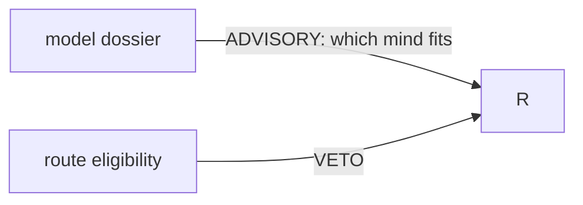

# Model dossier (advisory)

This file describes what each model is *like*, and records the standing
preferences that follow from it, so an orchestrator choosing between two
admissible routes can choose on judgement instead of looking a case up in a
table. It is the harness's opinion of the minds, not its rules about routing.

**The entries below are examples, not an enumeration.** Most real dispatch
decisions are not written here and never will be. Read the entries, form a view
of the models, then reason about the task in front of you. A task whose
character is absent is the normal case, not an error: reason from the nearest
entries and say which ones you reasoned from.

Read it before choosing a model. Prefer what it says. Depart from it when the
work calls for something else, and say why in the receipt.

All five adapters are enabled by default. `provenant route list` does not
probe; readiness is decided at dispatch.

## Advisory only

This file cannot change what is permitted. Nothing here is enforced by a schema
or a gate, and no script parses this file. It exists so preferences can be
written in a sentence, changed in a sentence, and read by whoever is about to
dispatch a leg.

- The Rust routing catalogue and current provider observations determine route
  availability.
- The dossier only ranks options that are *already* admissible. It never widens
  authority, never reaches an unavailable route, and never blocks a dispatch.
- If a preference here disagrees with a resolved route, the resolved route wins
  and the disagreement is a signal to fix the dossier, not the router.

## What this file does not own

| Content | Owner |
|---|---|
| Tiers, roles, efforts, degradation policy | `orchestrate` skill, routing reference |
| Route catalogue, resolution and receipt behaviour | `provenant route list` and `provenant route resolve` |
| Review-pressure ladder and risk tiers | `HARNESS.md` |
| Correlated-error caveat on cross-family review | `orchestrate` skill, routing reference |

Nothing above is restated here. If you want to know what a route *must* be, read
those. This file only helps you pick among what they already allow.

### Checking the live catalogue

The bundled catalogue defines models and default pools; `[domains.routing]`
config adds named routes and overrides; dispatch decides availability. Use
`provenant route list` to inspect them and `provenant route resolve` to check a
route or exact model. This dossier records advisory preferences; it does not set
aliases, weights or admissibility.

For numbers rather than judgement, see the
[model benchmark registry](research/model-benchmarks/README.md): published
scores, costs and the frontier effort range per model. Those are priors only
and never override a replay-bench or golden-task result.

## Entry format

Loose by design. An entry is a heading plus whatever labelled lines are worth
writing: `Good at`, `Watch out for`, `Cost`, `Reach`, or anything else that
turns out to matter. Nothing parses this file, so an unrecognised label, a new
model, a new category or a whole new provider is a plain text edit, with no code
change, no test to update and no schema to extend.

Where a field is blank, it is blank because nobody has recorded a view yet. Do
not read an absent `Watch out for` as an endorsement.

## Models

### Opus 5.5 (Anthropic principal)

- **Good at:** chairing, orchestration, hard reasoning and open-ended
  exploration. The default for critical review, synthesis and adjudication at
  every risk tier, ahead of Fable 5.1. Reserve it for that work; Sonnet 5.5 is
  the cheaper default elsewhere.
- **Watch out for:** the owner on Opus 5's long-form prose: "opus's writing is
  quite horrible". Hand human-facing prose to a voice pass (see
  [Human-facing final polish](#human-facing-final-polish)) rather than shipping
  Opus drafts as written.
- **Cost:** principal-tier; not separately characterised.
- **Reach:** consult `provenant route list`; only models exposed by the active
  Claude routes can be dispatched.

### GPT-6.1 Sol (OpenAI senior and principal)

- **Good at:** correctness, edge cases and precise work on a tight scope.
  Medium is the senior default; high is the principal default, with xhigh
  available there for harder work.
- **Watch out for:** the benchmark priors below vary by task. Revisit the
  Sol/Terra split using Provenant lane telemetry.
- **Cost:** on the Artificial Analysis Intelligence Index, max adds one point
  over xhigh at nearly twice the cost per task. Keep max available for exact
  model requests, outside all pools.
- **Reach:** `codex` adapter, `openai` family. The Codex models cache fetched
  2026-10-26T22:24Z records low, medium, high, xhigh and max. Consult the
  catalogue for each pool's narrower effort range.

### GPT-6.1 Terra (OpenAI senior and junior trial)

- **Good at:** a trial for ordinary implementation, research legwork, review
  and drafting in senior, and cheaper bounded work in junior. The benchmark
  priors support trying it, rather than assuming it replaces Sol.
- **Watch out for:** high and xhigh are unmeasured. Do not interpolate a
  performance claim for either. Revisit the senior and junior trials using
  Provenant lane telemetry.
- **Cost:** below Sol; see the sourced rates in `config/telemetry-prices.toml`.
- **Reach:** `codex` adapter, `openai` family. The owner verified
  `codex exec -m gpt-6.1-terra`. The Codex models cache fetched
  2026-10-26T22:24Z records low, medium, high, xhigh and max. The senior trial
  defaults to high and allows low through high; the junior trial defaults to
  low and allows low and medium.

#### Sol/Terra benchmark priors

These published results are priors, not Provenant lane measurements. Scores
from different benchmarks are not interchangeable; task costs are USD per task,
not token prices. Sources read 2026-10-27:

| Benchmark | Model and effort | Score | Cost per task |
|---|---|---|---|
| AA Intelligence Index | Sol low / medium / high / xhigh / max | 42 / 48 / 50 / 51 / 52 | $0.13 / $0.21 / $0.32 / $0.39 / $0.72 |
| AA Intelligence Index | Terra medium | 41 | $0.10 |
| AA Intelligence Index | Terra max | 48 | $0.40 |
| Terminal-Bench 4 | Terra low / medium / max | 24.8 / 35.8 / 50.3 | Not reported here |
| Terminal-Bench 4 | Sol medium / max | 52.7 / 55.9 | Not reported here |
| Agents' Last Exam | Terra low / medium / max | 55.9 / 57.6 / 60.0 | $0.16 / $0.29 / $1.01 |
| Agents' Last Exam | Sol medium / max | 53.8 / 58.6 | $1.31 / $2.00 |

The Sol Intelligence Index figures come from Artificial Analysis's
[low](https://artificialanalysis.ai/models/gpt-6-1-sol-low),
[medium](https://artificialanalysis.ai/models/gpt-6-1-sol-medium),
[high](https://artificialanalysis.ai/models/gpt-6-1-sol-high),
[xhigh](https://artificialanalysis.ai/models/gpt-6-1-sol-xhigh) and
[max](https://artificialanalysis.ai/models/gpt-6-1-sol) entries. Terra max
comes from [Artificial Analysis](https://artificialanalysis.ai/models/gpt-6-1-terra),
read 2026-10-27. Terra medium is secondary evidence from
[kingy.ai](https://kingy.ai/blog/gpt-6-1-terra/), published 2026-10-26,
citing Artificial Analysis. Terminal-Bench 4 is OpenAI-run, reported via that
kingy.ai article; Agents' Last Exam is OpenAI-run, reported via
[cellcog.ai](https://cellcog.ai/blog/gpt-6-1-terra/), read 2026-10-27.
Neither vendor-run benchmark is an independent reproduction. Terra high and
xhigh remain unmeasured in this evidence.

### GPT-6 Luna (OpenAI junior)

- **Good at:** cheap, high-token legwork and mechanical slices, and fan-out
  where several bounded opinions are worth more than one principal call.
- **Watch out for:** the owner found its predecessor, GPT-5.6 Luna, weak at
  design and motion, and prone to over-engineering a loose brief. Keep briefs
  tight and keep design work off it until GPT-6 Luna has its own record.
- **Cost:** very cheap; the owner's standing preference is to use Luna for
  smaller implementation and fixes where the catalogue offers it.
- **Reach:** `codex` adapter, `openai` family, in the `utility` pool after
  Claude Haiku.

### Sonnet 5.5 (Anthropic senior)

- **Good at:** the preferred Claude model for most work: implementation
  (including UI/frontend), research, screenshots, second opinions, ordinary
  review and lane leads. Cheaper than Opus 5.5 for about the same result, and
  probably better at design and taste.
- **Watch out for:** Opus 5.5 remains the choice for critical review,
  orchestration, crucial and terminal synthesis and hard reasoning.
- **Cost:** senior-tier.
- **Reach:** Claude adapter; check the current route list for the model
  selector and supported effort.

### Haiku 5.5 (Anthropic junior)

- **Good at:** cheap, fast bulk and mechanical slices on the Claude seat:
  extraction, classification, sweeps and bounded edits. It covers the low-effort
  work Sonnet used to take.
- **Watch out for:** judgement, review, design and anything where a miss is
  expensive; those stay on Sonnet 5.5 and Opus 5.5.
- **Cost:** cheapest Claude tier ($0.10/$0.50 per Mtok at launch).
- **Reach:** Claude adapter; first entry in the `utility` pool at low effort,
  before Codex Luna.

## Categories

Notes that are about a kind of work rather than one model. Add categories the
same way you add models.

### Adversarial red-team

Alignment-tuned models tend to be weaker at *playing* an attacker. A strong
code or agent family, handed an explicit defect taxonomy, tends to be the
sharper critic. Give it the artifact plus a checklist of failure types rather
than an open invitation to criticise.

### Long-context audit

Prefer an enabled route with enough context for the reading pass, then bring
the distilled result to the chair for the decision. The long-context model is
the reader, not the decider.

### Cheap bulk and scouting

Use `utility` for mechanical work: Claude Haiku has no explicit effort, Codex
Luna uses its recorded `low` control, and the OpenCode free models come last.
Use the named junior, senior or principal pools for increasing judgement, or
the writing and design pools for those crafts. Check `route list` for pool
membership and weights.

### Human-facing final polish

For reader-facing prose, consider a final pass from an enabled route chosen for
voice. Ask for rewrite advice or a suggested rewrite, then check every factual
claim against the source.

This is a suggestion, never a required leg. Three bounds keep it safe:

- **The chair owns substance.** Treat the return as a proposal. Adopt the
  phrasing, then diff it against the source for changed facts, numbers, names,
  citations, hedging and scope. A polish pass that alters meaning is rejected,
  not negotiated.
- **Human-facing work only.** Skip it for skills, specs, receipts, commit
  messages and other agent-facing files. Their readers are machines and the
  overhead buys nothing.
- **Last, not instead.** It follows the owning writing skill rather than
  replacing it; `natural-writing` and its specialists still own the doctrine.

This is an ordinary dispatch and follows the same authority and disclosure
rules as other routes.

### Effort as a substitute for tier

An effort-controllable principal can stand in for a mid model when the CLI
exposes effort control and the cost and latency are acceptable. Treat this as a
dated local heuristic rather than doctrine, and smoke-test the route against the
actual task before relying on it.

## Current preferences

Use `provenant route list` and `provenant route resolve` to inspect current
choices and the resolved model and effort. The bundled catalogue defines the
`utility`, `junior`, `senior`, `principal`, `writing` and `design` pools in
preference order. This advisory dossier does not change their membership or
order.

**Critical review has no fixed family.** The cross-family obligation is relative
to whoever chairs the run, so the right second family depends on the first. Do
not write a standing preference here; pick the family that is *not* the author's
and record it.

## Execution status

All five adapters are enabled for dispatch. A catalogue entry shows that a
model is configured, not that it is reachable; readiness depends on the local
sign-in and quota, which dispatch decides; `provenant route list` does not probe.

| Adapter | Models in the bundled pools |
|---|---|
| Claude | Haiku 5.5, Sonnet 5.5, Opus 5.5 |
| Codex | GPT-6 Luna, GPT-6.1 Terra, GPT-6.1 Sol |
| Agy | Gemini 3.8 Flash, Claude Sonnet 4.6, Claude Opus 4.6 Thinking |
| Cursor | Grok 4.7 |
| OpenCode | DeepSeek V4.1 Flash and GLM 5.3 Flash (free models) |

No other adapters exist.

## Recording the preference

Cite the entry heading when one of these entries actually decided a route. The
`orchestrate` skill's routing reference owns that convention and where the
citation goes; it is not repeated here.

## Maintenance

Edit this file directly. It needs no migration, no baseline and no regenerated
fixture, which is the entire point. If a preference here starts being treated as
binding, that is a bug in the caller, not a reason to formalise the file.

These notes are version-specific and they decay. That is expected and is the
reason the file is prose rather than a schema: a claim like "loves to
over-engineer but is very good at being correct" is worth writing down precisely
because it will stop being true, and rewriting one paragraph must cost nothing.

- A new model release is one new entry, not an audit of every use case.
- Delete a claim the moment it stops matching what you observe. A stale entry is
  worse than an absent one.
- Keep entries in the owner's own terms. Do not balance or soften an assessment,
  and do not invent one for a model nobody has used.
